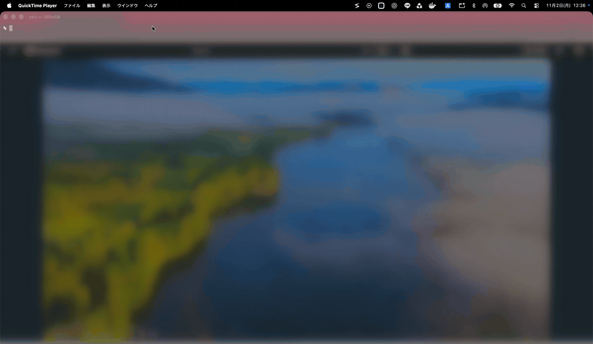
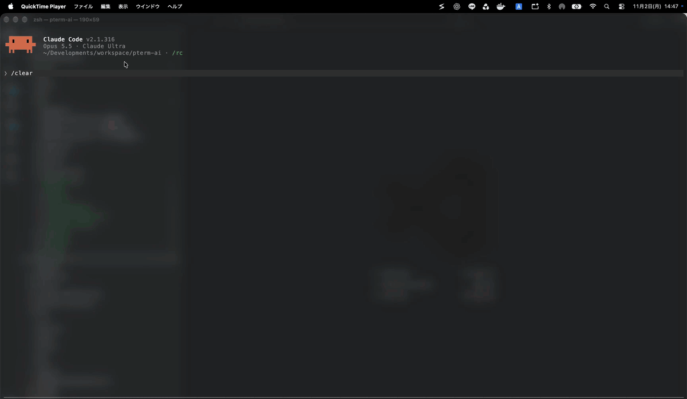

# Switch

[English](README.md) | **日本語** | [简体中文](README.zh-CN.md) | [한국어](README.ko.md)

**macOS のメニューバーで使うウィンドウ切り替えアプリ。目的のウィンドウへ、名前を見てワンクリックで移動できます。**

プロジェクトをいくつも開いていると、似たようなウィンドウの中から目的の 1 枚を探すことになります。Switch は、すべてのアプリのウィンドウを名前で一覧します。Word なら文書名、VS Code ならワークスペース名です。クリックするとそのウィンドウが画面いっぱいに広がり、同じアプリの他のウィンドウは最小化されます。Shift を押しながら複数選ぶと、横に並びます。



## 使い方

メニューバーのアイコンをクリックし、左でアプリを、右でウィンドウを選びます。

- **クリック** — そのウィンドウだけを画面いっぱいに表示します
- **Shift+クリック** — 複数を選びます。選んだ順に番号が付き、Shift を離すと左から順に横に並びます
- **Delete** — 選択中のアプリを、そのアプリの終了メニューと同じ方法で終了します。未保存の作業の確認が出れば、そこで答えられます
- **Esc** — パネルを閉じます

変わるのは選んだアプリだけです。最小化中のウィンドウを選ぶと元に戻り、同じアプリの他のウィンドウは最小化されます。

多くのアプリは、今いる Space のウィンドウと最小化中のウィンドウが、タイトルで一覧に出ます。

## VS Code に対応

たくさんのプロジェクトを同時に進めていますか。Switch は VS Code のウィンドウをワークスペース名で一覧します。ウィンドウのタイトルでは区別できない無題のワークスペースも同じです。別の Space にあるウィンドウも一覧に出て、選ぶとそこへ直接移動します。

空のウィンドウなど、ワークスペースのないウィンドウは **Other Windows** という別の区画に出ます。



## pterm に対応

複数のターミナルを単一のウィンドウで管理するターミナルアプリ [pterm](https://github.com/pontasan/pterm) をネイティブサポートしています。

pterm の入手先：https://github.com/pontasan/pterm

## 使いやすさの工夫

- **前面が分かる** — そのアプリで前面にあるウィンドウは、色で目立ちます
- **よく使うものをピン留め** — ピン留めしたアプリとウィンドウは一覧の上に固定され、再起動しても残ります
- **すぐ開く** — パネルはすぐに表示され、アプリの応答に合わせて更新されます。処理中のアプリがあっても待たされません
- **内容に合わせた高さ** — パネルは一覧に必要な高さになります
- **Liquid Glass** — パネルには macOS 標準のガラスを使っています
- **ログイン時に起動** — 初回の起動からオンです。右クリックのメニューの `Launch at Login` でオフにできます

## プライバシーとセキュリティ

外部のライブラリには依存せず、ネットワークに接続する処理もありません。サンドボックス内のアプリからは他のアプリのウィンドウを操作できないので、サンドボックスは使わず、App Store の外で配布しています。リリース版は Apple によるコード署名と公証を受けています。

Switch はウィンドウの読み取りと配置のためにアクセシビリティの権限を必要とし、起動時に許可を求めます。許可すると、再起動なしで使えるようになります。

非公開 API を 1 つだけ使っています。アクセシビリティのウィンドウとウィンドウ番号を結び付ける `_AXUIElementGetWindow` です。

## 動作環境

- macOS 26 (Tahoe) 以降
- Apple シリコン

## インストール

1. 最新の[リリース](../../releases)から `switch-darwin-arm64.zip` をダウンロードします。
2. zip をダブルクリックして展開します。
3. `Switch.app` を「アプリケーション」フォルダへドラッグします。
4. `Switch.app` を開きます。Dock アイコンもウィンドウもないので、メニューバーのアイコンを探してください。

### アクセシビリティの許可

Switch はウィンドウの読み取りと配置のためにアクセシビリティの権限を必要とします。初回の起動時に macOS が許可を求めるので、そのダイアログからシステム設定を開き、一覧の **Switch** をオンにします。

**macOS 27** で自分で開く場合は、次の手順です。

1. アップルメニューから **システム設定** を選びます。
2. サイドバーの **プライバシーとセキュリティ** をクリックします。
3. **デバイスの制御とデータへのアクセス** をクリックします。
4. 一覧の **Switch** をオンにします。

**macOS 26** で自分で開く場合は、次の手順です。

1. アップルメニューから **システム設定** を選びます。
2. サイドバーの **プライバシーとセキュリティ** をクリックします。
3. **アクセシビリティ** をクリックします。
4. 一覧の **Switch** をオンにします。

ダイアログを閉じてしまった場合は、メニューバーのアイコンをクリックし、パネルの **Open Settings** で再び表示できます。

## 開発

```bash
make test    # 単体テスト
```

アプリのビルドには署名用の ID が必要です。macOS はアクセシビリティの権限を署名に結び付けるためです。git の対象外の `local.mk` に、ご自身のものを記入してください。

```make
IDENTITY = Developer ID Application: Your Name (TEAMID)
```

あとは `make run` でデバッグ版をビルドして起動するか、`make build` でリリース版をビルドします。

## ライセンス

[MIT](LICENSE)
