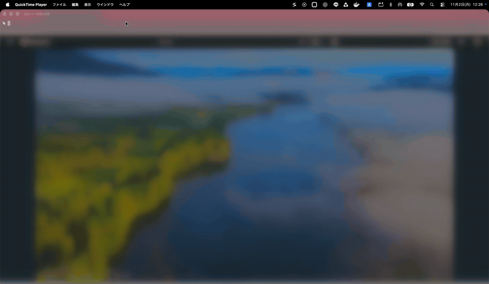
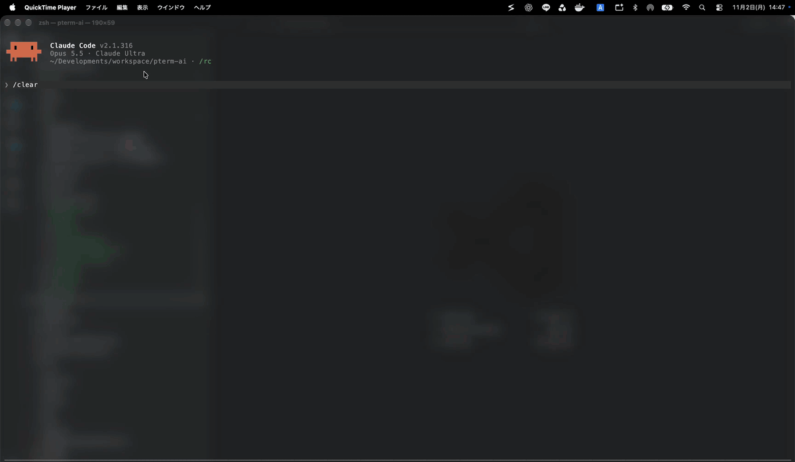
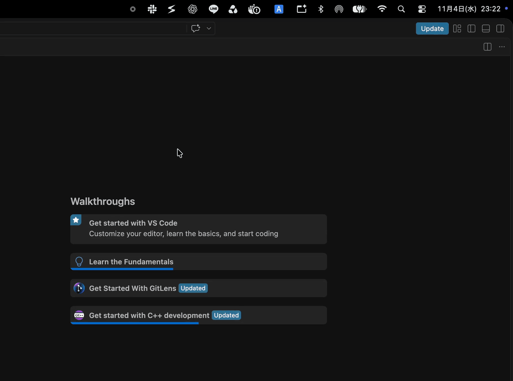

# Switch

[English](README.md) | [日本語](README.ja.md) | [简体中文](README.zh-CN.md) | **한국어**

**macOS 메뉴 막대 윈도우 전환 앱. 원하는 윈도우를 이름으로 찾아 클릭 한 번으로 이동하세요.**

프로젝트를 여러 개 열어 두면 비슷비슷한 윈도우 사이에서 원하는 것을 찾아 헤매게 됩니다. Switch는 모든 앱의 윈도우를 이름으로 보여 줍니다. Word는 문서 이름으로, VS Code는 워크스페이스 이름으로 표시합니다. 하나를 클릭하면 화면을 가득 채우고, 같은 앱의 나머지 윈도우는 최소화됩니다. Shift를 누른 채 여러 개를 선택하면 나란히 배치됩니다.



## 사용 방법

메뉴 막대 아이콘을 클릭하고, 왼쪽에서 앱을, 오른쪽에서 윈도우를 선택합니다.

- **클릭** — 해당 윈도우만 화면 가득 표시합니다
- **Shift+클릭** — 여러 개를 선택합니다. 클릭한 순서대로 번호가 붙고, Shift에서 손을 떼면 왼쪽부터 나란히 배치됩니다
- **Delete** — 선택한 앱을 해당 앱의 종료 메뉴와 같은 방식으로 종료합니다. 저장하지 않은 작업을 묻는 경우 직접 답할 수 있습니다
- **Esc** — 패널을 닫습니다
- **다음 윈도우 단축키**(시스템 설정에서 바꾸지 않았다면 ``Command+` ``) — 앞에 있는 앱에 표시된 윈도우가 1개 이하이면 macOS에는 전환할 윈도우가 없으므로 대신 이 패널이 열립니다. 다시 누르면 다음 행으로, Shift를 함께 누르면 이전 행으로 이동하며, 위아래 화살표 키도 사용할 수 있습니다. 영문자나 숫자를 누르면 해당 문자로 시작하는 행으로 이동하고, 같은 문자를 다시 누르면 다음 행으로 이동합니다. 키에서 손을 떼면 해당 윈도우를 표시합니다

선택한 앱만 변경됩니다. 최소화된 윈도우를 선택하면 복원되고, 해당 앱의 다른 윈도우는 최소화됩니다.

대부분의 앱은 현재 Space의 윈도우와 최소화된 윈도우를 제목으로 표시합니다.

## VS Code 지원

여러 프로젝트를 동시에 작업하고 있나요? Switch는 VS Code 윈도우를 워크스페이스 이름으로 표시합니다. 윈도우 제목으로는 구분할 수 없는 제목 없는 워크스페이스도 마찬가지입니다. 다른 Space에 있는 윈도우도 목록에 나타나며, 선택하면 바로 이동합니다.

빈 윈도우처럼 워크스페이스가 없는 윈도우는 별도의 **Other Windows** 영역에 표시됩니다.



Switch는 선택한 윈도우만 표시하고 나머지는 최소화합니다. 그런 다음 다음 윈도우 단축키(기본값 ``Command+` ``)를 누르면 최소화된 윈도우로 키보드만으로 전환할 수 있습니다.



## pterm 지원

하나의 윈도우에서 여러 터미널을 관리하는 터미널 앱 [pterm](https://github.com/pontasan/pterm)을 기본 지원합니다.

pterm 받기: https://github.com/pontasan/pterm

## 편리한 기능

- **앞에 있는 윈도우 확인** — 앱에서 가장 앞에 있는 윈도우는 색으로 강조됩니다
- **자주 쓰는 항목 고정** — 고정한 앱과 윈도우는 목록 맨 위에 유지되며, 다시 시작해도 그대로입니다
- **바로 열림** — 패널이 즉시 나타나고 앱의 응답에 따라 업데이트되므로, 바쁜 앱 때문에 기다리지 않습니다
- **내용에 맞는 높이** — 패널은 목록에 필요한 만큼의 높이가 됩니다
- **Liquid Glass** — 패널에 macOS 표준 글래스를 사용합니다
- **로그인 시 실행** — 처음 실행할 때부터 켜져 있습니다. 오른쪽 클릭 메뉴의 `Launch at Login`에서 끌 수 있습니다

## 개인정보 보호 및 보안

외부 라이브러리에 의존하지 않으며, 네트워크에 연결하는 기능도 없습니다. macOS는 샌드박스 앱이 다른 앱의 윈도우를 제어하는 것을 허용하지 않으므로, Switch는 샌드박스를 사용하지 않고 App Store 외부에서 배포됩니다. 릴리스 버전은 Apple의 코드 서명과 공증을 받았습니다.

Switch는 윈도우를 읽고 배치하기 위해 손쉬운 사용 권한이 필요하며, 실행할 때 권한을 요청합니다. 허용하면 다시 시작하지 않아도 바로 사용할 수 있습니다.

비공개 API는 하나만 사용합니다. 손쉬운 사용 윈도우를 윈도우 번호와 연결하는 `_AXUIElementGetWindow`입니다.

## 시스템 요구 사항

- macOS 26 (Tahoe) 이상
- Apple 실리콘

## 설치

1. 최신 [릴리스](../../releases)에서 `switch-darwin-arm64.zip`을 다운로드합니다.
2. zip 파일을 이중 클릭하여 압축을 풉니다.
3. `Switch.app`을 '응용 프로그램' 폴더로 드래그합니다.
4. `Switch.app`을 엽니다. Dock 아이콘이나 윈도우가 없으므로 메뉴 막대에서 아이콘을 찾으세요.

### 손쉬운 사용 권한 허용

Switch는 윈도우를 읽고 배치하기 위해 손쉬운 사용 권한이 필요합니다. 처음 실행할 때 macOS가 권한을 요청하므로, 해당 대화상자에서 시스템 설정을 열고 목록에서 **Switch**를 켭니다.

**macOS 27**에서 직접 이동하는 방법은 다음과 같습니다.

1. Apple 메뉴를 열고 **시스템 설정**을 선택합니다.
2. 사이드바에서 **개인정보 보호 및 보안**을 클릭합니다.
3. **기기 제어 및 데이터 접근**을 클릭합니다.
4. 목록에서 **Switch**를 켭니다.

**macOS 26**에서 직접 이동하는 방법은 다음과 같습니다.

1. Apple 메뉴를 열고 **시스템 설정**을 선택합니다.
2. 사이드바에서 **개인정보 보호 및 보안**을 클릭합니다.
3. **손쉬운 사용**을 클릭합니다.
4. 목록에서 **Switch**를 켭니다.

대화상자를 닫은 경우 메뉴 막대 아이콘을 클릭하고 패널의 **Open Settings**를 사용하면 다시 표시됩니다.

## 개발

```bash
make test    # 단위 테스트
```

앱을 빌드하려면 서명 ID가 필요합니다. macOS가 손쉬운 사용 권한을 서명 ID에 연결하기 때문입니다. git에서 제외되는 `local.mk`에 자신의 ID를 입력하세요.

```make
IDENTITY = Developer ID Application: Your Name (TEAMID)
```

그런 다음 `make run`으로 디버그 빌드를 빌드하고 실행하거나, `make build`로 릴리스 빌드를 빌드합니다.

## 라이선스

[MIT](LICENSE)
