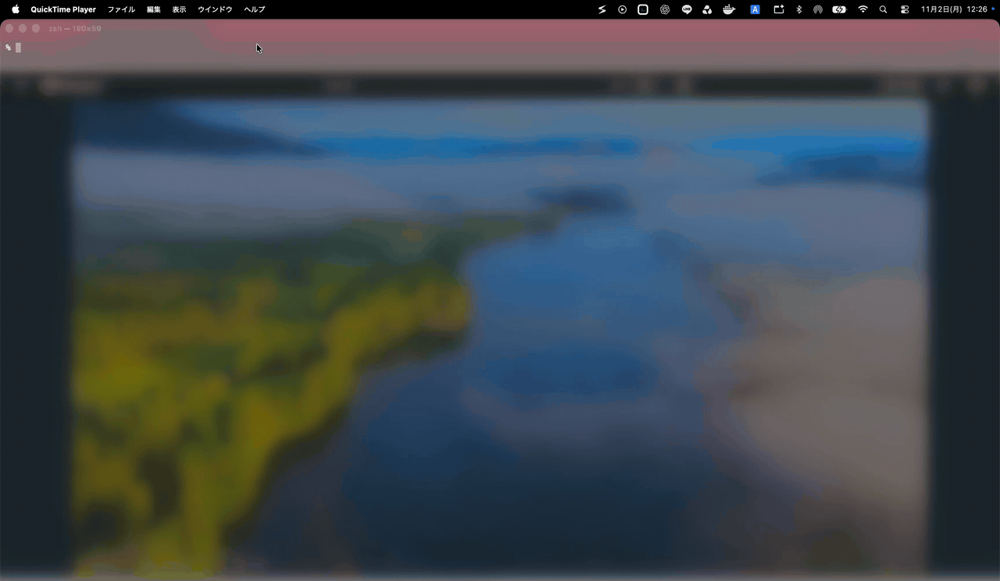

# Switch

**English** | [日本語](README.ja.md) | [简体中文](README.zh-CN.md) | [한국어](README.ko.md)

**A macOS menu bar window switcher. Jump straight to the window you want, by name, in one click.**

With a dozen projects open, finding the right window means hunting through look-alikes. Switch lists every app's windows by name: Word by document, VS Code by workspace. Click one and it fills the screen while the rest of that app's windows minimize. Shift-click several and they line up side by side.



## How It Works

Click the menu bar icon, pick an app on the left, then pick a window on the right.

- **Click** — show that window alone, filling the screen
- **Shift+click** — pick several, numbered in click order. Release Shift and they line up side by side, left to right
- **Delete** — quit the selected app, the same way its Quit menu does. If the app asks about unsaved work, you still get to answer
- **Esc** — close the panel

Only the app you picked changes. A minimized window you pick comes back, and that app's other windows minimize.

Most apps are listed with their window titles, for the current Space and minimized windows.

## Built for VS Code

Working on many projects at once? Switch lists VS Code windows by workspace name, even untitled workspaces whose window titles can't tell them apart. Windows on other Spaces are listed too, and Switch takes you straight there.

Windows without a workspace, such as an empty window, appear under a separate **Other Windows** section.

## Built for pterm

Natively supports [pterm](https://github.com/pontasan/pterm), a terminal app that manages multiple terminals in a single window.

Get pterm: https://github.com/pontasan/pterm

## Handy Details

- **See what's in front** — the window in front of its app stands out in color
- **Pin what you use** — pinned apps and windows stay at the top of their lists, and the pins survive a restart
- **Opens instantly** — the panel shows right away and updates as apps answer, so a busy app can't hold it up
- **Fits its contents** — the panel is as tall as the list needs
- **Liquid Glass** — the panel uses the standard macOS glass
- **Launch at login** — on from the first launch. Turn it off with `Launch at Login` in the right-click menu

## Privacy and Security

Zero third-party dependencies, and nothing that connects to a network. Switch does not sandbox, because macOS does not let a sandboxed app control other apps' windows, so it is distributed outside the App Store. Releases are code signed and notarized by Apple.

Switch needs the Accessibility permission to read and arrange windows, and asks for it on launch. It starts working as soon as you allow it, without a restart.

One private API is used: `_AXUIElementGetWindow`, which ties an Accessibility window to its window number.

## Requirements

- macOS 26 (Tahoe) or later
- Apple silicon

## Install

1. Download `Switch.zip` from the latest [release](../../releases).
2. Double-click the zip to unzip it.
3. Drag `Switch.app` into your `Applications` folder.
4. Open `Switch.app`. It has no Dock icon or window: look for its icon in the menu bar.

### Allow Accessibility

Switch needs the Accessibility permission to read and arrange windows. macOS asks for it on the first launch: open System Settings from that dialog, then turn on **Switch** in the list.

To get there yourself on **macOS 27**:

1. Open the Apple menu and choose **System Settings**.
2. Click **Privacy & Security** in the sidebar.
3. Click **Device Control and Data Access**.
4. Turn on **Switch** in the list.

On **macOS 26**:

1. Open the Apple menu and choose **System Settings**.
2. Click **Privacy & Security** in the sidebar.
3. Click **Accessibility**.
4. Turn on **Switch** in the list.

If you dismissed the dialog, click the menu bar icon and use **Open Settings** in the panel to bring it back.

## Development

```bash
make test    # unit tests
```

Building the app needs a signing identity, because macOS ties the Accessibility permission to it. Put yours in `local.mk`, which git ignores:

```make
IDENTITY = Developer ID Application: Your Name (TEAMID)
```

Then use `make run` to build and launch a debug build, or `make build` for a release build.

## License

[MIT](LICENSE)
