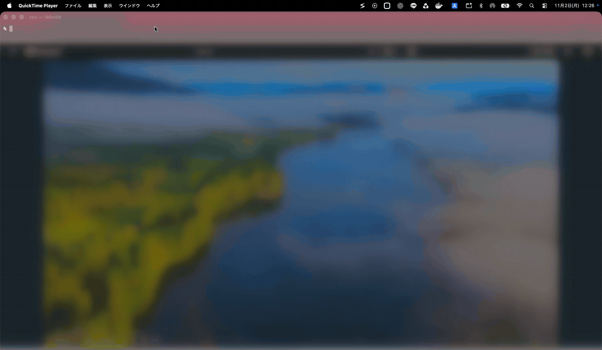
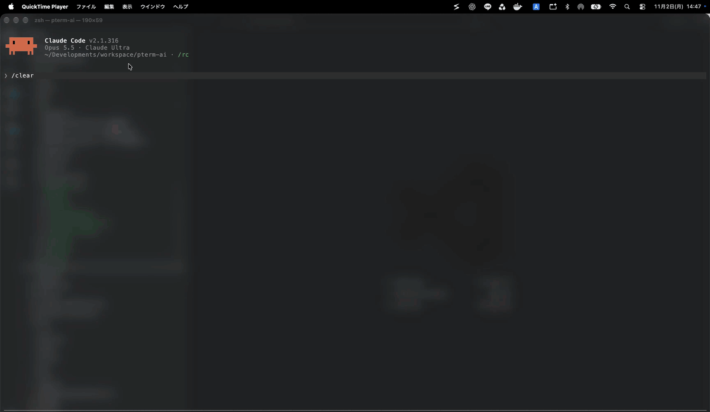
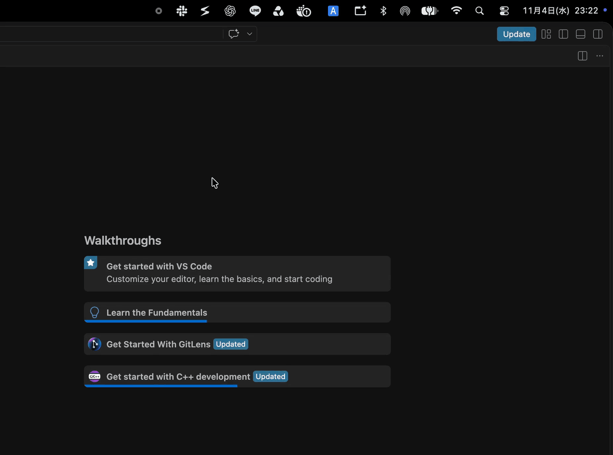
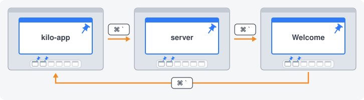
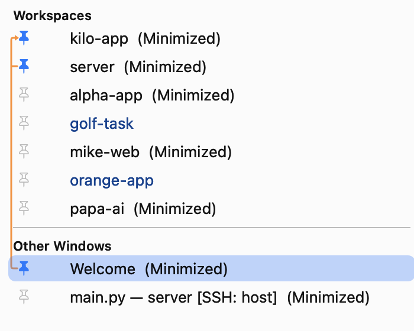
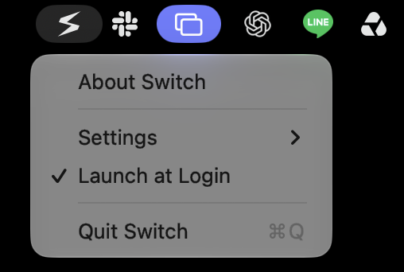
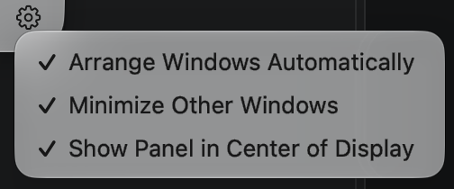
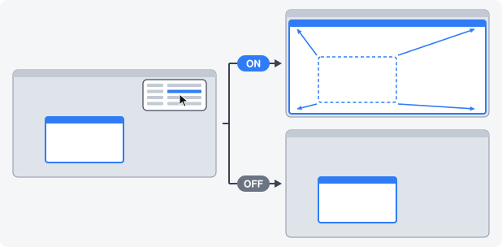
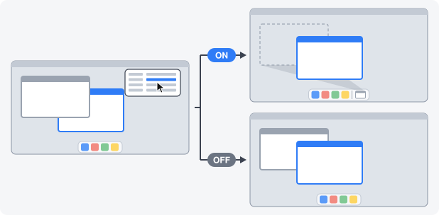
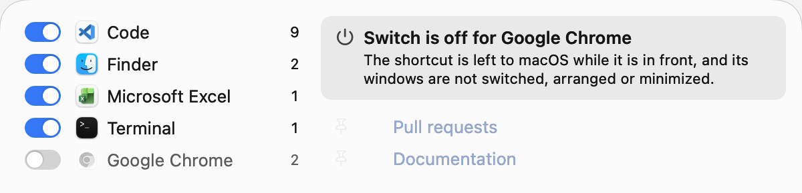

# Switch

[English](README.md) | [日本語](README.ja.md) | **简体中文** | [한국어](README.ko.md)

**macOS 菜单栏窗口切换工具。按名称查找，一键直达想要的窗口。**

同时打开许多项目时，要在一堆相似的窗口中寻找目标并不容易。Switch 按名称列出所有应用的窗口：Word 显示文稿名称，VS Code 显示工作区名称。点按一个窗口，它就会铺满屏幕，同一应用的其他窗口则会最小化。按住 Shift 选择多个窗口，它们会并排显示。



## 使用方法

点按菜单栏图标，在左侧选择应用，再在右侧选择窗口。

- **点按** — 仅显示该窗口，并使其铺满屏幕
- **Shift+点按** — 选择多个窗口，并按点按顺序编号。松开 Shift 后，它们会从左到右并排显示
- **Delete** — 退出所选应用，方式与该应用的退出菜单相同。如果应用询问未保存的工作，你仍可以作答
- **Esc** — 关闭面板
- **下一个窗口快捷键**（未在系统设置中更改时为 ``Command+` ``） — 无论显示多少个窗口，都会打开此面板。此快捷键由 Switch 代替 macOS 接收，即使其他应用正在显示密码输入框也能使用。再次按下可移到下一行，加按 Shift 可回到上一行，也可使用上下箭头键。按字母或数字可移到以该字符开头的行，再次按同一字符可移到下一个匹配行。松开按键即可显示该窗口

只有你选择的应用会发生变化。选择已最小化的窗口时，它会恢复显示，该应用的其他窗口则会最小化。 铺满屏幕和最小化都可以在[设置](#设置)中分别关闭。

大多数应用会按窗口标题列出当前空间中的窗口和已最小化的窗口。

## 为 VS Code 打造

同时处理很多项目？Switch 按工作区名称列出 VS Code 窗口，即使是窗口标题无法区分的无标题工作区也能分辨。其他空间中的窗口同样会列出，选择后 Switch 会直接带你前往。

没有工作区的窗口（例如空窗口）会显示在单独的 **Other Windows** 分区中。



Switch 只显示你选择的窗口，并最小化其余窗口。之后按下一个窗口快捷键（默认为 ``Command+` ``），即可用键盘切换到已最小化的窗口。



## 在已固定的窗口间循环

在众多窗口中，固定你当前正在处理的几个。无论应用还有多少其他窗口，下一个窗口快捷键（默认为 ``Command+` ``）都只在已固定的窗口之间循环，一个键就能在正在处理的窗口间来回切换。要固定窗口，请点按面板中窗口行左侧的图钉。请固定同一应用的 2 个以上窗口。



在面板中，橙色线条将已固定的窗口连接起来，并指回第一个窗口。上下箭头键和字母、数字仍可移到所有行。



## 为 pterm 打造

原生支持 [pterm](https://github.com/pontasan/pterm)，一款在单个窗口中管理多个终端的终端应用。

获取 pterm：https://github.com/pontasan/pterm

## 设置

可通过右键点击菜单栏图标选择 `Settings`，或点击面板右下角的齿轮进行更改。更改立即生效，重启后仍会保留。

| 右键点击菜单栏图标 | 面板右下角的齿轮 |
| --- | --- |
|  |  |

| 设置 | 默认 | 作用 | 适用场景 |
| --- | --- | --- | --- |
| `Arrange Windows Automatically` | 开 | 让所选窗口适应屏幕（多个时并排） | 在宽屏显示器或 Apple Vision Pro 虚拟显示器上关闭，可保持窗口的大小和位置 |
| `Minimize Other Windows` | 开 | 将同一应用的其他窗口收进程序坞 | 需要同时查看其他窗口时关闭 |
| `Show Panel in Center of Display` | 关 | 在显示器中央而不是图标下方打开面板 | 在宽屏显示器等图标离工作位置较远时开启 |

| | |
| --- | --- |
| `Arrange Windows Automatically` |  |
| `Minimize Other Windows` |  |
| `Show Panel in Center of Display` |  |

## 贴心细节

- **一眼看清显示中的窗口** — 未最小化的窗口（包括并排显示的窗口）都会以颜色突出显示
- **按应用关闭 Switch** — 关闭应用行左侧的开关后，Switch 将不再处理该应用。该应用位于前台时，下一个窗口快捷键按 macOS 原本的方式工作，面板也不会切换、排列或最小化它的窗口。已关闭的应用会移到列表底部，图标变为灰色。所有应用默认开启<br>
  
- **固定常用窗口** — 已固定的窗口会保持在应用列表顶部，重新启动后依然保留
- **即刻打开** — 面板立即显示，并随应用的响应而更新，忙碌的应用不会拖慢它
- **高度随内容调整** — 面板的高度正好容纳列表
- **Liquid Glass** — 面板使用 macOS 标准玻璃效果
- **登录时启动** — 首次启动后即开启。可在右键菜单的 `Launch at Login` 中关闭

## 隐私与安全

没有任何第三方依赖，也没有任何连接网络的功能。macOS 不允许沙盒应用控制其他应用的窗口，因此 Switch 未使用沙盒，并在 App Store 之外分发。发布版本已由 Apple 进行代码签名和公证。

Switch 需要辅助功能权限才能读取和排列窗口，并会在启动时请求该权限。授权后无需重新启动即可使用。

Switch 仅使用一个私有 API：`_AXUIElementGetWindow`，用于将辅助功能窗口与其窗口编号对应起来。

## 系统要求

- macOS 26 (Tahoe) 或更高版本
- Apple 芯片

## 安装

1. 从最新的[发布版本](../../releases)下载 `switch-darwin-arm64.zip`。
2. 连按 zip 文件进行解压。
3. 将 `Switch.app` 拖到“应用程序”文件夹。
4. 打开 `Switch.app`。它没有程序坞图标，也没有窗口，请在菜单栏中查找它的图标。

### 允许辅助功能权限

Switch 需要辅助功能权限才能读取和排列窗口。macOS 会在首次启动时请求该权限：从对话框打开系统设置，然后在列表中打开 **Switch**。

在 **macOS 27** 上手动前往的步骤如下：

1. 打开苹果菜单，选择**系统设置**。
2. 点按边栏中的**隐私与安全**。
3. 点按**设备控制和数据访问**。
4. 在列表中打开 **Switch**。

在 **macOS 26** 上手动前往的步骤如下：

1. 打开苹果菜单，选择**系统设置**。
2. 点按边栏中的**隐私与安全**。
3. 点按**辅助功能**。
4. 在列表中打开 **Switch**。

如果你关闭了对话框，请点按菜单栏图标，然后使用面板中的 **Open Settings** 重新显示。

## 开发

```bash
make test    # 单元测试
```

构建应用需要签名身份，因为 macOS 会将辅助功能权限与其绑定。请将你的身份写入 git 忽略的 `local.mk`：

```make
IDENTITY = Developer ID Application: Your Name (TEAMID)
```

然后使用 `make run` 构建并启动调试版本，或使用 `make build` 构建发布版本。

## 许可证

[MIT](LICENSE)
